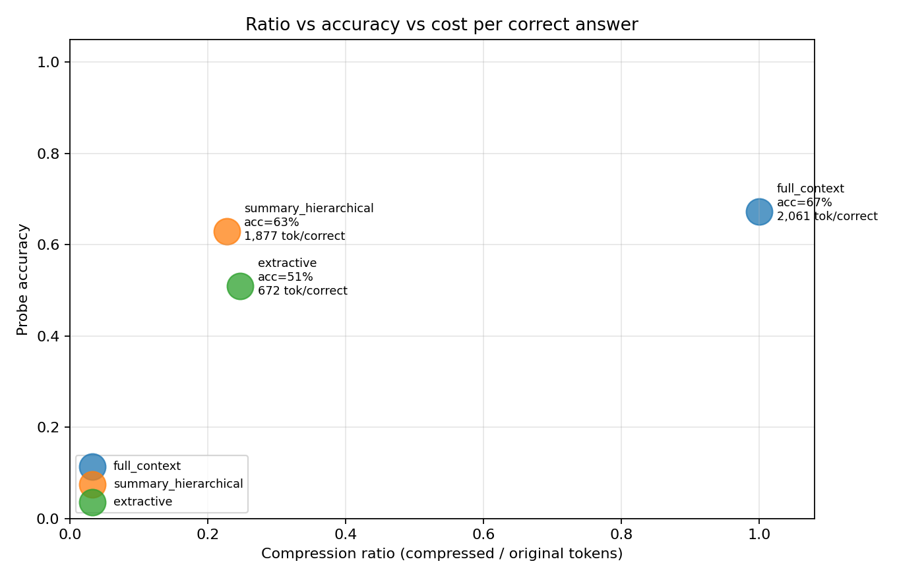
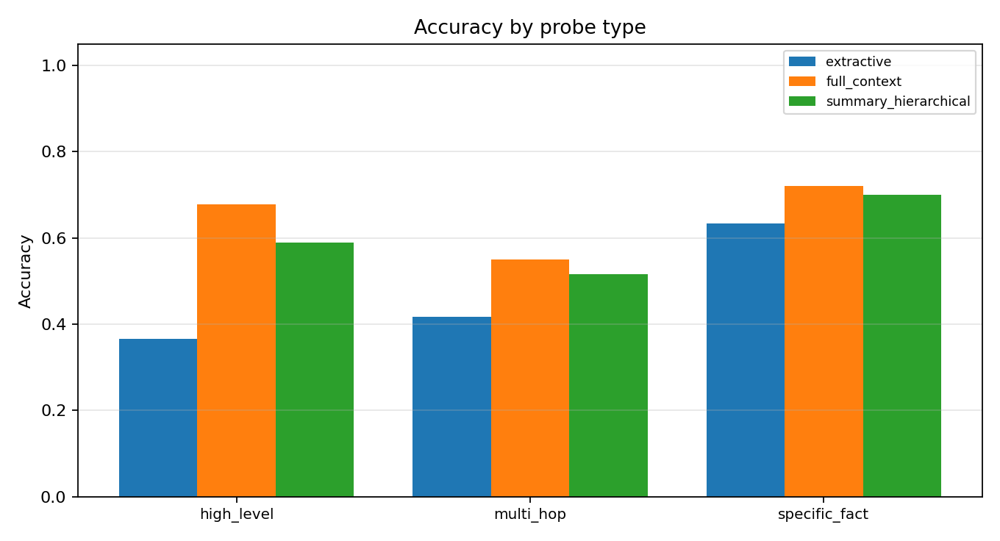
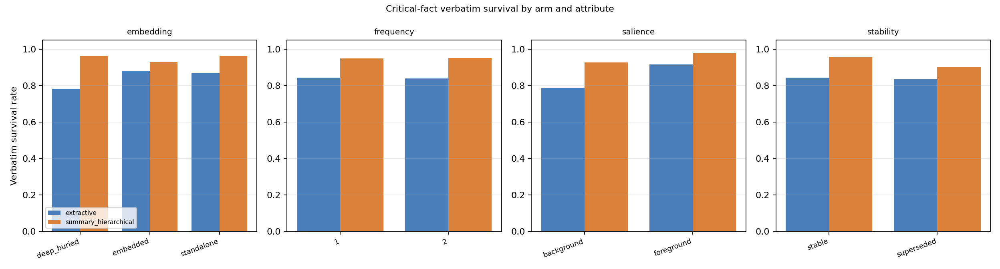

# Agent Memory-Compression Fidelity Audit

> **Thesis: compression ratio is not the goal - cost per correct answer is.**

A benchmark that asks a different question from the compression literature: not *how small can the memory get*, but *how much does each correct answer cost once compression has had its way with the history*.

## 1. Setup

- **Sessions**: 30 synthetic agent-user histories, 840 turns total (22-30 per session).
- **Raw history**: 41,627 tokens (avg 1,387/session).
- **Ground-truth facts**: 220 critical information units with annotated frequency / salience / embedding depth / stability.
- **Probes**: 300 questions across three types (high-level, specific-fact, multi-hop).
- **Arms**: full context (baseline) + summary_hierarchical, extractive.
- **Judge**: independent model from the answerer (`DeepSeek-V4-Pro-Official` vs `glm-5.3-flash`).
- **Summarizer**: `DeepSeek-V4-Flash-Official`.
- **Experiment token spend**: 1,655,739 tokens across 1902 calls.

## 2. The three-dimensional comparison

| Arm | Compression ratio | Context tokens | + Compression cost | Accuracy | Correct probes | **Tokens per correct answer** | vs baseline |
|---|---|---|---|---|---|---|---|
| full_context | 100.0% | 416,270 | 0 | 67.3% | 202/300 | **2,061** | 0.0% |
| summary_hierarchical | 22.7% | 94,610 | 260,121 | 63.0% | 189/300 | **1,877** | -8.9% |
| extractive | 24.7% | 102,820 | 0 | 51.0% | 153/300 | **672** | -67.4% |

Cost per correct answer is reported **amortized** (compression cost included). One-shot context-only figures are in `metrics.json`.



## 3. The economics: which paradigm actually pays

Baseline (no compression) costs **2,061 tokens per correct answer** at 67.3% accuracy.

| Arm | Ratio | Accuracy | Correct | Tokens/correct | vs baseline | Verdict |
|---|---|---|---|---|---|---|
| summary_hierarchical | 22.7% | 63.0% | 189/300 | 1,877 | -8.9% | **cheaper** OK |
| extractive | 24.7% | 51.0% | 153/300 | 672 | -67.4% | **cheaper** OK |

**The two paradigms fail in opposite directions.**

- `summary_hierarchical` reaches a 22.7% ratio and retains 63.0% accuracy - yet lands at -8.9% versus baseline, because producing the summary itself costs 260,121 tokens. Compression is not free: you pay once to shrink the memory, and at these session lengths the amortization never happens.
- `extractive` reaches a similar ratio (24.7%) and retains 51.0% accuracy, but costs 0 tokens to produce, so it lands at -67.4%. Selection is nearly free; generation is not.

So the naive comparison - *which compressor shrinks more?* - has almost no discriminating power here (the two ratios differ by 2.0%). The comparison that decides the engineering question is *which one is cheaper per correct answer*, and it separates them by tens of percent.

**When would the summary arm pay off?** It saves about 10,722 tokens of context per session but spends 260,121 tokens to build all 30 summaries. The summarization is therefore amortized only if each compressed memory is reused roughly **24.3+ times** - i.e. for long-lived memories, not one-shot probes. This is the condition under which abstraction beats selection, and it is a property of the *workload*, not of the compressor.


## 4. Accuracy by probe type

| Arm | high_level | multi_hop | specific_fact |
|---|---|---|---|
| full_context | 67.8% | 55.0% | 72.0% |
| summary_hierarchical | 58.9% | 51.7% | 70.0% |
| extractive | 36.7% | 41.7% | 63.3% |



## 5. When is compression actually worth it?

Compression reduces cost per correct answer **iff** the accuracy it destroys is smaller than the tokens it saves:

```
cost_per_correct(compressed) < cost_per_correct(full)
  <=>  (R * T_full) / (A_comp * N) < T_full / (A_full * N)
  <=>  R / A_comp < 1 / A_full
  <=>  A_comp / A_full > R        # accuracy retention must exceed the token ratio
```

- Measured compression ratio R - **24.7%**
- Measured accuracy retention A_comp / A_full -**75.7%**
- Breakeven verdict: **compression_pays_off**
- Maximum ratio that would still have paid off: **75.7%** (actual was 24.7%).

**Bottom line**: Measured over 300 probes: `extractive` costs 672 tokens per correct answer (-67.4% vs the 2,061 baseline) at 51.0% accuracy; `summary_hierarchical` costs 1,877 tokens per correct answer (-8.9% vs the 2,061 baseline) at 63.0% accuracy. The summary arm's apparent advantage is fragile: it only exists because each memory was reused more than once here, and it needs ~24 reuses per memory before abstraction breaks even. Both arms beat the baseline on this workload, which is the condition the benchmark identifies: compression pays off only while the accuracy it removes costs less than the tokens it saves.

## 6. Failure analysis: what got lost, and why

- Probes correct in full context but wrong after compression: **84** of 600 comparable probes (14.0%).
- Critical facts that vanish verbatim from the compressed text: **41** of 215.

**Fact survival differs sharply by arm.** Pooling the two compressors hides the finding, so the per-arm breakdown is the one that matters:

| Attribute | Value | extractive | summary_hierarchical |
|---|---|---|---|
| embedding | deep_buried | 78.2% (n=78) | 96.2% (n=78) |
| embedding | embedded | 88.1% (n=84) | 92.9% (n=84) |
| embedding | standalone | 86.8% (n=53) | 96.2% (n=53) |
| frequency | 1 | 84.3% (n=134) | 94.8% (n=134) |
| frequency | 2 | 84.0% (n=81) | 95.1% (n=81) |
| salience | background | 78.5% (n=121) | 92.6% (n=121) |
| salience | foreground | 91.5% (n=94) | 97.9% (n=94) |
| stability | stable | 84.3% (n=185) | 95.7% (n=185) |
| stability | superseded | 83.3% (n=30) | 90.0% (n=30) |

**53 of the 84 lost probes have every fact they depend on still present verbatim in the compressed memory.** The information was retained and the answer is still wrong. Two mechanisms produce this, and neither is visible in a token-level retention metric:

> **Value confusion.** When a session revises a value, a compressed memory often keeps *both* the stale and the current one. The literal string survives, so a verbatim-survival metric scores it as retained - but the reader has no cue for which is current and reports the wrong one. **Retrieval failure.** The value is in the memory but the answerer does not surface it, e.g. because the probe asks for it indirectly or the memory has grown noisy around it.

Cases where the expected value is absent from the answer while present in the memory:

| Probe | Arm | Type | Expected (current) | Answered |
|---|---|---|---|---|
| s001-p00 | extractive | high_level | `Objective: harden the deployment p` | `Objective: a service migration, pinned to v3` |
| s001-p02 | extractive | high_level | `~/.config/svc/credentials.env` | `Yes - two revisions: the package manager was` |
| s001-p03 | extractive | specific_fact | `~/.config/svc/credentials.env` | `~/.config/svc/token.env` |
| s003-p00 | extractive | high_level | `Objective: harden the deployment p` | `The session tracked a migration pinned to ru` |
| s005-p02 | summary_hierarchical | high_level | `v0.8.9` | `Only the baseline reproduction/submission de` |
| s006-p07 | summary_hierarchical | specific_fact | `v2.0.1` | `arXiv:2405.12904v3 (Okafor et al.)` |
| s007-p03 | extractive | specific_fact | `imperial units only` | `Lunch at 13:00.` |
| s008-p00 | extractive | high_level | `Objective: reorganise the weekly s` | `The session was a routine review to keep pro` |
| s008-p00 | summary_hierarchical | high_level | `Objective: reorganise the weekly s` | `Session objective: routine status maintenanc` |
| s008-p05 | extractive | specific_fact | `no weekend work` | `I don't know.` |

This is why the report leads with *cost per correct answer* rather than with a retention ratio: a memory can score well on every token-level retention metric and still be actively misleading, and only an answer-level metric prices that in.

**Pooled survival by attribute** (both arms, fact counted as surviving if it survived in any arm):

- **embedding** - deep_buried: 98.7% (n=78); embedded: 97.6% (n=84); standalone: 98.1% (n=53)
- **salience** - background: 97.5% (n=121); foreground: 98.9% (n=94)
- **frequency** - 1: 97.8% (n=134); 2: 98.8% (n=81)
- **stability** - stable: 97.8% (n=185); superseded: 100.0% (n=30)

**Loss rate by probe type** - the type that survives abstraction best is not the one that survives extraction best:

| Probe type | Compared | Lost | Loss rate |
|---|---|---|---|
| high_level | 180 | 41 | 22.8% |
| multi_hop | 120 | 14 | 11.7% |
| specific_fact | 300 | 29 | 9.7% |

**Representative true losses** (the fact's literal value is gone from the compressed memory):

| Probe | Arm | Type | Fact value | Kind | Freq | Salience | Embedding |
|---|---|---|---|---|---|---|---|
| s005-p01 | extractive | high_level | `Kaggle:longctx-2026` | dataset_source | 2 | background | deep_buried |
| s005-p04 | extractive | specific_fact | `Kaggle:longctx-2026` | dataset_source | 2 | background | deep_buried |
| s005-p05 | extractive | specific_fact | `no-proprietary-data` | constraint | 1 | background | embedded |
| s005-p08 | extractive | multi_hop | `Kaggle:longctx-2026` | dataset_source | 2 | background | deep_buried |
| s006-p01 | extractive | high_level | `Kaggle:longctx-2026` | dataset_source | 1 | background | deep_buried |
| s006-p04 | extractive | specific_fact | `Kaggle:longctx-2026` | dataset_source | 1 | background | deep_buried |
| s006-p09 | extractive | multi_hop | `Kaggle:longctx-2026` | dataset_source | 1 | background | deep_buried |
| s011-p02 | extractive | high_level | `pip-tools` | package | 2 | foreground | standalone |
| s011-p03 | extractive | specific_fact | `pip-tools` | package | 2 | foreground | standalone |
| s011-p08 | extractive | multi_hop | `pip-tools` | package | 2 | foreground | standalone |
| s014-p05 | extractive | specific_fact | `max-8k-context` | constraint | 2 | background | embedded |
| s015-p00 | extractive | high_level | `v0.9.2` | version | 1 | background | deep_buried |



## 7. Reproducing

```bash
python scripts/bootstrap.py            # vendor tiktoken (one-time)
python -m memfaith.run --n-sessions 30 --probes 10 --tag full
python -m memfaith.run --n-sessions 3 --probes 6 --tag smoke   # quick check
python -m pytest tests -q              # offline unit tests
```

## 8. Limitations

- Synthetic histories: controlled redundancy/criticality beats realism but understates the messiness of real transcripts.
- Judge is an LLM: verdicts are noisy at the margin; the report keeps the raw judge output so verdicts can be re-audited.
- Two compression arms, not the full design space; LLMLingua-2 is available behind a flag but not the default (no model download in this environment).
- Token counts use cl100k_base as a neutral proxy, not the answerer's own tokenizer.
